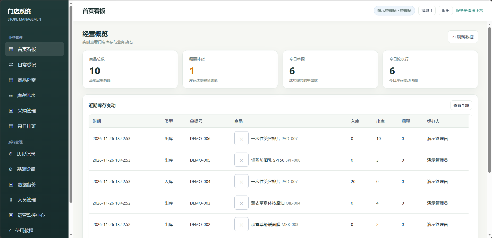
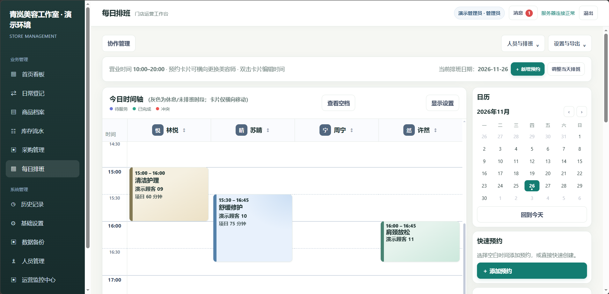

# 美容门店库存与排班管理系统

面向美容门店的局域网管理系统，使用 FastAPI、SQLite 和浏览器页面。当前源码版本为 **1.6.0-rc.18**。

- 库存与采购支持商品档案、条码录入和扫码、库存流水、采购入库与 Excel 导出。
- 排班与预约支持美容师班次、多人预约、可约时间计算、休息时间块、候补和客户档案。
- 门店管理支持员工与权限组、操作审计、经营报表、全量备份与恢复。

安装、建档、预约、授权和备份操作见[详细使用教程](docs/USER_GUIDE.md)。

## 界面截图

截图均使用合成演示数据。

### 库存看板



### 每日排班



商品建档界面可参见[新增商品截图](docs/screenshots/inventory-products.png)。

## Windows 本地试跑

在项目目录打开 PowerShell，使用 Python 3.11 或 3.12。以下命令在首次试跑时创建虚拟环境和示例运行配置。

```powershell
python -m venv .venv
.\.venv\Scripts\python.exe -m pip install -r requirements.txt
New-Item -ItemType Directory -Force data | Out-Null
if (!(Test-Path data/config.json)) {
    '{"port":8000,"https":false,"auto_backup":false}' | Set-Content -Encoding utf8 data/config.json
}
.\.venv\Scripts\python.exe main.py --headless
```

在浏览器打开 `http://127.0.0.1:8000/`，按页面提示创建管理员。以上示例关闭 HTTPS，仅用于可信环境试跑。服务会监听所有本机网络接口，请保持防火墙限制。手机访问使用局域网地址，摄像头扫码通常需要浏览器信任的 HTTPS。

源码包只提供示例配置。首次启动时会在 `data/` 初始化空库，请用合成商品、员工和预约试跑。在另一个终端执行 `.\.venv\Scripts\python.exe main.py --stop-local` 可请求正常停服。

## Windows 构建与现有安装

运行 `build_windows.bat`，输出位于 `release/库存管理服务器.exe`。对新安装，程序在 EXE 所在目录初始化 `data/`；升级现有安装时，请保留原运行目录及其数据、配置和备份。

[RC18 升级和回退说明](RELEASE_CANDIDATE_1_6_0_RC18.md) 针对单独分发的 RC17 → RC18 增量包，命令需要该包内的 `apply_release_candidate.py`。仓库里的 `apply_upgrade.ps1` 是历史开发测试脚本，只接受 1.4.0 源码基线，并要求在独立测试目录传入 `-DevelopmentTestOnly`。

## 开发与验证

安装 Node.js 可运行前端模拟用例。

```powershell
.\.venv\Scripts\python.exe -m pip install -r requirements-dev.txt
.\.venv\Scripts\python.exe -m pytest -q
.\.venv\Scripts\python.exe scripts/verify_project.py
```

请在没有真实业务数据的临时源码副本中运行写入测试。项目预检可以直接检查纯源码目录。

| 位置 | 职责 |
| --- | --- |
| `main.py` | 应用组合、路由适配、兼容入口和 Windows 管理窗口 |
| `store_inventory/` | 权限、账号、库存、采购、排班、平台等模块及其适配器 |
| `static/` | 库存、每日排班等浏览器页面 |
| `tests/`、`test_smoke.py` | 自动化验证 |
| `upgrade_payload/` | 保留历史升级流程使用的源码、文档和测试载荷 |

架构按业务职责逐步拆分，入口仍保留兼容逻辑、部分业务编排与桌面窗口。参见[架构准则](docs/ARCHITECTURE_V1_6.md)、[项目维护约定](AGENTS.md)及[变更记录](CHANGELOG.md)。
