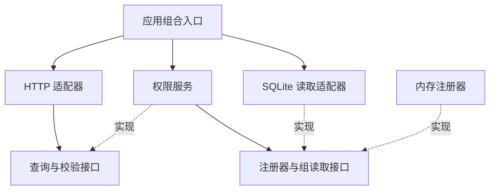

# V1.6 架构准则与 dev.6 实施边界

## 设计原则

本项目后续升级以**模块化、面向接口、依赖倒置**为基础，并结合单一职责、开闭原则、接口隔离和适度设计。

模块按业务职责划分；业务逻辑依赖小而稳定的接口；HTTP、SQLite、文件、桌面窗口等具体技术在边界接入。入口负责组装依赖，新模块不反向导入入口。可替换的实现必须有真实测试证明，避免只改目录、不改变依赖关系。

对于有明显取舍的重大设计问题，给出可行方案、优缺点、改动成本和推荐理由，由用户决定。普通实现细节直接按本准则执行。

## dev.6 已实施：权限模块

| 文件 | 职责 | 依赖方向 |
|---|---|---|
| `domain.py` | 权限元数据、路由策略、规则组授权、判定结果 | Python 标准库 |
| `ports.py` | 注册器、规则组读取、权限查询、可信模块接入契约 | 领域类型 |
| `defaults.py` | 旧权限键、默认定义、组禁授权限 | 无运行时资源 |
| `legacy_policy.py` | 旧业务路由权限映射，保留 any 语义 | 无数据库或 Web 框架 |
| `service.py` | 权限判定、组并集、目录、快照、规则校验、路由判定 | 领域类型与接口契约 |
| `registry.py` | 内存模块注册器、路由验证和冲突检测 | 领域类型 |
| `sqlite_groups.py` | 读取当前 SQLite 规则组及成员关系 | 注入的连接工厂 |
| `http.py` | 三个 v1 HTTP 接口、输入验证、请求守卫 | `PermissionChecks` 接口 |
| `composition.py` | 创建每个应用独立的服务与适配器 | 具体实现，仅在入口使用 |
| `main.py` | 注入 `db` 连接工厂、安装路由、兼容旧调用入口 | 已组装的权限服务 |

以上模块位于 `store_inventory/permissions/`。

`PermissionService` 不导入 FastAPI、SQLite、Tkinter 或 `main`，可注入内存规则组读取实现独立运行。`create_permission_service(connect)` 每次构造独立注册器，构造时不访问数据库、不创建配置或日志，不使用进程共享注册单例。

SQLite 适配器每次读取当前组成员与授权，不缓存；已有登录 Cookie 会在下一次请求看到授权或撤权。正在执行的请求仍使用该次认证得到的快照，不代表事务中途强制撤销。

## 新模块的接入方式

参见 `examples/loyalty_module.py`。模块提供 `install(app, permissions)`，`permissions` 参数声明为 `ModulePermissions`；在可信启动代码中注册权限、策略和实际路由。组合入口再调用安装函数。

示例默认**不挂载**，没有真实会员业务或数据写入。需要上线实际会员功能时，单独实现业务服务和仓储接口；不要把示例当成功能交付。

推荐步骤：

1. 明确模块拥有的数据、操作以及访问权限。
2. 用最小接口表达存储与外部依赖；业务实现不导入 `main`。
3. 为每条扩展 API 注册权限策略，数据相关动作再使用请求守卫。
4. 由入口注入具体实现并安装路由。
5. 测试允许、拒绝、异常、撤权与兼容行为，再接入页面。

## 保持兼容的边界

- HTTP API 路径、`schema_version=1`、当前会话查询及 `Cache-Control: no-store` 保持不变。
- `main.register_permission_module`、`main.register_permission_route`、`main.permission_granted`、`main.require_permission` 保留兼容门面。
- `main.PERMISSION_LABELS`、`main.DEFAULT_STAFF_PERMISSIONS`、`main.GROUP_FORBIDDEN_PERMISSIONS` 保留原名称。
- `permission_extension.py` 保留旧类型导入；其中 `REGISTRY` 仅用于旧代码独立构建注册器。应用使用自己拥有的注册器，直接修改该模块全局 `REGISTRY` 不会注册到应用，应改用上述兼容门面或注入接口。
- 旧业务 API 的权限键及 any 组合规则保持不变；此轮没有改变旧业务的 CRUD 权限粒度。
- 普通组禁止授予系统敏感权限；扩展 `admin_only` 对非管理员始终拒绝。
- 未知权限键对管理员也返回 false；未注册策略的扩展路由对管理员也拒绝。
- 暂时停用模块的历史组授权仍保留，但在模块缺席时无效。

## 同轮边界修复

dev.5 使用两个样例路径检查策略重叠，可能漏掉 `/records/{record_id}/edit` 与 `/records/fixed/{action_id}` 在 `/records/fixed/edit` 的交集。dev.6 按路径段精确检查支持的静态段和单段参数；有交集的同方法策略拒绝注册，与注册顺序无关。不同方法、不相交路径仍可注册。

规则组 JSON 若损坏或不是对象，SQLite 读取适配器视为无授权，避免登录阶段因 `.items()` 调用失败而崩溃。数据库连接无论成功或失败均关闭。

## 尚未拆分的内容

dev.6 是架构演进的第一个模块化检查点，**不是全系统架构重写**。账号与会话、权限组管理写入及审计、库存与采购、排班、备份恢复、Tkinter 管理窗口仍主要位于 `main.py`。数据库 schema 保持 8；没有数据库迁移或生产部署。

后续逐模块迁移时沿用本次接口与组装方式。应优先保持营业行为兼容，将代码拆分与业务权限语义变更分别验收；涉及新的权限模型或数据迁移时提供具体选项。

## 自动化验收

- `tests/test_v160_dev6_permission_architecture.py`：无框架核心导入、无文件副作用、内存仓储替换、应用实例隔离、交叉路由冲突、组合权限、敏感权限、坏 JSON、连接异常关闭、HTTP 注入、可信扩展示例。
- dev.5 权限集成测试继续覆盖组编辑、即时撤权、停用模块历史授权保留、匿名访问、当前会话和未知权限拒绝。
- 其余既有测试覆盖商品、扫码、排班、备份、网络稳定性和发布准备。
- 原始数据库与配置逐字节校验；开发源码与升级载荷保持同步。
