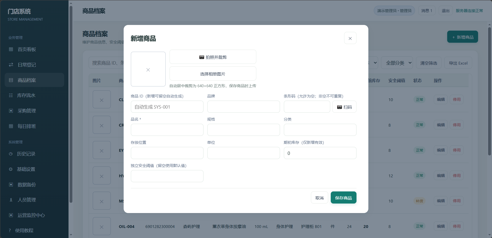

# 美容门店库存与排班管理系统使用教程

适用于 `1.6.0-rc.18`。一台 Windows 电脑运行门店服务器，店长和员工从浏览器登录。办公室电脑、前台电脑和手机接入同一台服务器，操作结果会写入同一门店数据库。员工端可直接使用手机浏览器打开。

| 你要做什么 | 从这里开始 |
| --- | --- |
| 新店部署、开员工账号、分配权限、设置商品与排班 | [管理员操作](#管理员操作) |
| 员工首次登录、查商品、记库存单或处理预约 | [员工日常操作](#员工日常操作) |
| 手机连接门店系统、扫码、查看当天预约 | [手机端操作](#手机端操作) |

文中的商品、员工和顾客均为演示数据。普通员工的菜单、日期和可修改范围以管理员分配的规则组及绑定的美容师档案为准。

## 管理员操作

### 1. 安装服务器并创建管理员

1. 打开 [GitHub Releases](https://github.com/hackC/beauty-store-management/releases/tag/v1.6.0-rc.18)，下载 Windows x64 ZIP。从同页下载 `SHA256SUMS.txt`，核对其中 Windows ZIP 的校验值。在下载目录打开 PowerShell，执行：

   ```powershell
   Get-FileHash -LiteralPath '.\beauty-store-management-1.6.0-rc.18-windows-x64.zip' -Algorithm SHA256
   ```

2. 将 ZIP 解压到可写目录，例如 `D:\StoreInventory`。双击 `库存管理服务器.exe`，在管理窗口点击 **启动服务**，等服务就绪后点击 **打开库存系统**。
3. 在首次初始化页输入管理员账号、姓名和自设密码，点击 **创建管理员并进入系统**。记录管理窗口中的 **IP 访问**地址和端口，稍后给门店员工和手机使用。
4. 回到 **首页看板**，检查右上角连接状态。新库首次打开时，商品数、近期流水和排班数据为空。EXE 同目录会生成 `data/` 与 `logs/`，下次在同一目录运行会读取原有数据。


从源码试跑、编译 EXE 和运行自动化测试，见 [README](../README.md#windows-本地试跑)。

### 2. 创建岗位规则组和员工账号

1. 进入左侧 **人员管理**，找到 **权限规则组**，点击 **新建规则**。例如建「前台接待」和「库存登记」两个组。在规则编辑页按岗位勾选具体动作并保存。
2. 在 **人员管理 → 注册人员**填写登录账号和姓名。首次登录码可填写自定义 8 位数字、使用已设置的管理员默认码，或留空随机生成。
3. 在 **所属权限规则组（可多选）**勾选该员工的岗位组，点击 **保存人员**。员工加入多个组时，权限取各组授权的并集。桌面端也可在规则组页面将员工拖入组，手机端可用下拉选择加入。
4. 有本人排班权限的美容师，先在 **每日排班 → 人员与排班 → 人员管理**建好美容师档案，再回到员工账号编辑窗口，在 **绑定排班美容师档案**选择对应档案。
5. 私下把账号和一次性登录码交给本人。用员工账号试登录，分别检查能否进入应有菜单、提交应有业务、看到应有的排班范围。登录码遗失时，在人员列表重新生成。员工离岗时调整组成员或禁用账号，变更会在后续请求生效。

| 岗位示例 | 适合核对的权限 |
| --- | --- |
| 前台接待 | 查看排班和空档，按岗位需要创建或处理预约。涉及客户信息时核对字段的可见范围。 |
| 库存登记 | 查商品、查看库存流水，按职责授权入库、出库或盘点。 |
| 美容师 | 查看本人预约。允许操作本人当天安排时，核对对应权限和美容师档案绑定。 |

### 3. 商品建档、条码与低库存

1. 打开 **商品档案 → 新增商品**，填写品名、规格、分类、存放位置与单位。商品 ID 可留空自动生成，也可用唯一的店内编号，例如 `HYD-001`。
2. 有商品条码时，在 **条码**框输入完整号码，或点击同一行的 **扫码**绑定。保留条码前导零，非空条码必须唯一。没有条码可留空。
3. 根据第一次实物盘点填写 **期初库存**。填写 **独立安全阈值**可以为该商品设置单独的预警线，留空使用默认值。需要商品照片时，选 **拍照并裁剪**或**选择相册图片**，点击 **保存商品**后上传。
4. 回到商品档案，搜索新商品，核对条码、库存、单位和阈值。日后有实物变动时走 **日常登记**，建档的期初库存仅在新增时生效。



进入 **采购管理**查看 **待补货清单**。当前库存小于或等于有效安全阈值时会列入清单。用 **导出采购单 Excel**选择字段并导出。到货后，以实际收货数量在 **日常登记**提交入库，回到清单核对是否仍需补货。

例如舒缓面膜现有 5 件，安全阈值为 10 件，商品会出现在待补货清单。实际收到 12 件后登记入库，库存变为 17 件，超过阈值后退出清单。

### 4. 设置营业时间、班次和服务项目

1. 打开 **每日排班 → 设置与导出 → 营业时间**，设置门店实际营业时间。
2. 打开 **人员与排班 → 人员管理**维护美容师。继续进入 **项目类型**建立分类，再到 **真实项目**添加服务、时长和等待时间。
3. 在 **人员与排班 → 排班规则 → 新建规则**建立早班、晚班或固定班，填写每日工作时段并分配人员。若员工 `10:00–13:00`、`14:00–19:00` 在岗，可分成两段填写。
4. 打开 **休息安排**维护休息和临时出勤。临时出勤覆盖指定日期的休息规则，其他日期仍按原规则计算。临时换班时，可在时间轴先选日期，再点 **调整当天排班**核对该日人员和班次。
5. 用 **查看空档**检查排班是否符合预期。需要为某人安排临时休息时，可在 **真实项目**配置一个时长为 0 分钟的项目。新增预约时单独选择它，填写美容师、开始时间和休息时长，点 **保存休息**。这段时间会从可预约时间中扣除，删除休息块后会按班次重新计算。

### 5. 每日检查、备份和升级

- **营业前**检查服务器状态、看板的低库存预警、当天班次和首批预约。**营业后**用 **库存流水**核对单据，在 **每日排班 → 设置与导出 → 导出日报**核对预约明细。
- 在 **运营监控中心**按需要查看 **库存预警**、**操作审计**、**美容师负荷**和**经营报表**。协作请求可在排班的 **协作管理 → 我的申请 / 审批**查看。
- 在 **数据备份 → 立即备份**创建备份，成功后选择 **下载全量备份（ZIP）**，另存到受控的第二份存储。到 **基础设置**核对自动备份时间和保留策略。
- 恢复前让员工暂停登记，先保存当前备份。选择全量备份 ZIP 执行 **恢复备份**。全量 ZIP 可恢复数据库、商品图片和采购附件，恢复时沿用当前版本的页面、功能和服务设置。恢复完成后用备份内的账号重新登录，检查商品、库存流水和最近预约。
- 升级前正常停止服务，保留旧 EXE 和原运行目录的完整备份。按目标版本说明在原运行目录操作，保留 `data/` 与实际配置。RC17 到 RC18 的增量与回退方法见 [RC18 发布说明](../RELEASE_CANDIDATE_1_6_0_RC18.md)。

## 员工日常操作

### 1. 首次登录和值班交接

1. 打开管理员提供的门店地址，输入分配的登录账号。在 **密码或首次登录码**填入管理员发给你的 8 位码，点击 **登录系统**。
2. 按提示设置个人登录密码，至少 8 位。以后使用自己的密码登录。收到「已使用」或找不到登录码时，联系管理员重新生成。
3. 登录后确认右上角是自己的账号。上班先核对当天日期和要处理的工作。交接班时检查正在编辑的单据或预约是否已经保存，共用电脑上点击 **退出**再交给下一位员工。

### 2. 查库存和登记单据

1. 在 **商品档案**用商品 ID、条码、品名或规格搜索，核对规格、单位、存放位置与当前库存。
2. 打开 **日常登记**，选 **业务类型**。需要关联供货单或内部领用单时，填写 **外部单据编号**。经办人由当前登录账号自动带入。
3. 点击 **添加商品**，输入搜索词并从候选结果选中正确规格。填写 **数量 / 实盘**，可以添加多条明细，并按需要写备注。
4. 核对业务类型、商品、单位和数量，点 **提交单据**。看到成功后，到 **库存流水**按时间、单号或商品核对，再到商品档案检查余额。若网络中断且页面提示上一笔未确认，先查看流水并按页面提示重试原单，避免另起一张重复单据。

| 你手上的业务 | 业务类型 | 填写示例 |
| --- | --- | --- |
| 收到 12 件面膜 | 入库 | 填 `12` |
| 从仓柜领用 3 件面膜 | 出库 | 填 `3`，库存不足时先核对实物及未登记的入库 |
| 账面显示 20 件，实物数了 17 件 | 盘点调整 | 填实盘总数 `17`，系统计算盘亏 3 件。实盘为零可填 `0`。 |

### 3. 接待、预约和服务完成

1. 打开 **每日排班**，用日历选预约日期。先核对页面的 **当前排班日期**，再查看美容师列和时间轴。灰色区表示休息或未排班。
2. 不确定时段时点 **查看空档**，按需要选择日期、人员与服务时长，找到可用时间后再开预约。项目时长、等待时间和当天人的班次都会影响结果。
3. 点 **新增预约**，填写美容师、日期、开始时间、项目和顾客称谓。按业务需要填写手机尾号和备注。同行预约可在表单里分别设置同行者的项目及时间，再按提示确认整组安排。
4. 点击 **保存预约**。在当天时间轴找到新卡片，核对人员、开始时间及项目。顾客改期或换美容师时，打开已有卡片修改，核对调整后的时间。服务结束后按权限调整预约状态。
5. 碰到冲突提示，回到时间轴核对同一美容师的预约、休息及班次。碰到「排班已被其他设备更新」，关闭旧编辑窗口，同步或刷新后重新打开该预约。
6. 有排班协作权限的员工，可在 **协作管理**选本人、日期与申请类型，填写时段或换班对象后点 **提交申请**。在 **我的申请 / 审批**查看状态。


## 手机端操作

### 1. 连接服务器并打开菜单

1. 手机加入门店 Wi-Fi，确认和服务器电脑在同一局域网。如果接入了访客网络，先请管理员确认访客网络能否访问门店电脑。
2. 打开系统浏览器，输入管理员提供的完整 **IP 访问**地址或已配置的域名。例 `https://192.168.1.20:8000/`，其中地址和端口以管理窗口显示为准。手机上的 `localhost` 和 `127.0.0.1` 指向手机自己。
3. 按[员工首次登录步骤](#1-首次登录和值班交接)登录。页面底部可见 **首页、登记、商品、采购、排班**等常用入口，显示项随权限变化。需要库存流水、历史记录或人员管理时，打开页面左上角的菜单。
4. 手机上能打开但想确认连对门店时，对照系统名称、服务器连接状态和自己账号。无法打开时，请前台先在服务器电脑确认服务就绪，再核对地址、网络和防火墙。

### 2. 手机扫码入库、出库和盘点

1. 确认浏览器已经信任门店 HTTPS 证书。用底部 **登记**进入 **日常登记**，点右上方 **手机扫码**。扫码入口会新建商品明细，手上已有未提交的明细时先完成或核对该单。
2. 选择 **扫码入库**、**扫码出库**或**扫码盘点**。只会显示当前账号有权限的类型。浏览器询问时允许摄像头，使用后置摄像头对准商品包装上的一维条码。
3. 识别成功后，检查品名、规格和单位。扫码入库或出库可能带入数量 `1`，要改成实际数量。扫码盘点要填写实盘总数，例如现数到 `0` 件就填 `0`。
4. 需要登记其他商品时可在同一单据点 **添加商品**，搜索并选择商品后填写数量。确认所有明细，点 **提交单据**，到 **库存流水**核对结果。
5. 仅想查商品时，进入底部 **商品 → 扫码查询**。如果识别出条码却找不到对应商品，可改用名称或商品 ID 查询，并反馈管理员核对商品档案的条码绑定。

### 3. 手机查排班、加预约和回看结果

1. 底部点 **排班**，用日历选择日期。纵向滑动时间轴查看其他时段，人员列未完整显示时横向滑动时间轴。
2. 点 **查看空档**确认时间，或点 **新增预约**直接登记。填写日期、人员、开始时间、项目、顾客和必要备注，滑到表单操作区点击 **保存预约**。
3. 回到当天时间轴核对预约卡片。已有预约需要变更时优先打开卡片表单，检查新时间后保存。账号仅能操作本人当天排班时，人员或日期项可能受限制。
4. 没有 **新增预约**、**查看空档**或修改按钮时，检查当前账号权限并联系管理员核对。偶尔断线时先确认原操作是否保存，再决定是否重试。

### 4. 手机摄像头或 HTTPS 证书报错

| 现象 | 处理 |
| --- | --- |
| 页面有证书警告 | 让管理员检查手机访问的地址是否与证书一致。在受控设备上安装并信任门店的 CA 后重新打开网页。 |
| 扫码页打不开摄像头 | 确认页面使用受信任的 HTTPS，系统与浏览器均允许摄像头。权限拒绝过时，在浏览器的网站权限中重新授权。 |
| 实时画面正常但一直识别失败 | 对准一维商品条码、避开反光并调整距离。可切换 **拍照识别条码**，也可返回手动搜索商品。 |
| 页面提示备用扫码库不可用 | 改用手动条码或商品名称登记。该浏览器需要备用扫码库时，设备需能访问该库。 |
| 识别到条码但商品不存在 | 核对条码号码或改用商品 ID，联系管理员补录或修正绑定。 |

管理员如需配置局域网 HTTPS，可在 Windows 管理窗口进入 **服务器设置**启用 HTTPS。证书和私钥路径都留空时，系统可自动生成本地证书。按门店设备管理方式，仅向受控手机分发用于信任的本地 CA 证书，服务器与 CA 的私钥留在服务器。

## 常见问题

| 现象 | 到哪里检查 |
| --- | --- |
| 今天突然找不到旧商品和排班 | 核对 EXE 所在目录、访问的服务器地址以及 `data/inventory.db`。把 EXE 放到另一个目录运行会初始化新库。 |
| 出库登记报库存不足 | 打开商品档案和库存流水，核对规格、数量、先前入库是否已记账以及是否选错同名商品。 |
| 预约开始时间不可选 | 核对当前日期、营业时间、当天班次、休息块、已有预约和休息前预约门槛。 |
| 员工换岗后仍能看到旧菜单 | 核对该员工是否仍在其他授权组。调整后刷新页面，并用员工账号实测操作范围。 |
| 只有一个旧版 `.db` 文件 | 旧数据库用于恢复数据库。需要同时恢复商品图片和采购附件时，使用全量 ZIP。 |
