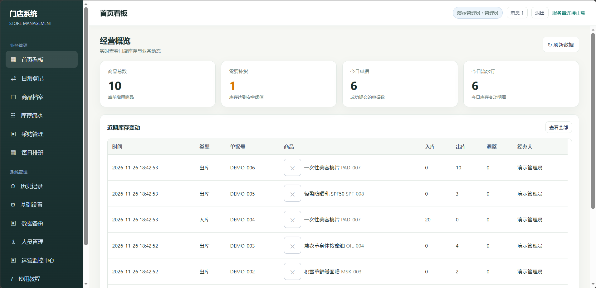
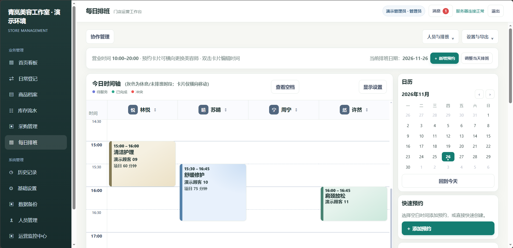

# 美容门店库存与排班管理系统使用教程

适用于 `1.6.0-rc.18`。门店电脑负责运行服务器，店长和员工可以在同一局域网内通过浏览器使用库存、采购和排班。下文的商品、员工和预约均为演示数据。

## 1. Windows 安装与首次登录

1. 打开 [GitHub Releases](https://github.com/hackC/beauty-store-management/releases/tag/v1.6.0-rc.18)，下载 `beauty-store-management-1.6.0-rc.18-windows-x64.zip`。需要校验时，从同一页面下载 `SHA256SUMS.txt`，在 PowerShell 中运行 `Get-FileHash -LiteralPath '.\beauty-store-management-1.6.0-rc.18-windows-x64.zip' -Algorithm SHA256`，核对对应文件的哈希值。
2. 将 ZIP 解压到当前账号可写的独立目录，例如 `D:\StoreInventory`。双击 `库存管理服务器.exe` 打开管理窗口。
3. 点击 **启动服务**。服务就绪后，点击 **打开库存系统**。若需用其他设备访问，记录管理窗口里的 **IP 访问**地址和端口。
4. 在浏览器的首次初始化界面创建管理员账号。用自己的管理员密码登录，确认首页可打开、商品列表为空。
5. 首次运行会在 EXE 所在目录创建 `data/` 和 `logs/`。日常启动继续使用同一个目录，系统会读取其中原有的数据库和配置。

从源码试跑、编译 EXE 和运行自动化测试的步骤见 [README](../README.md#windows-本地试跑)。

## 2. 建商品档案和设置补货阈值

1. 进入 **商品档案 → 新增商品**，填写商品 ID、品名、规格、分类和存放位置。商品 ID 可留空由系统生成，也可使用 `HYD-001` 一类唯一的店内编码。
2. 有厂家条码的商品可以录入或扫码绑定，保存时检查非空条码是否重复。录入时保留原始条码的前导零。没有条码的商品也可保存。
3. 初次建档时按盘点结果填写期初库存，设置安全阈值。此后的到货、领用和盘点通过 **日常登记**记账。
4. 在商品档案按品名、商品 ID 或条码搜索。进入 **采购管理**查看待补货清单。当前库存小于或等于有效安全阈值时，商品进入清单，可点击 **导出采购单 Excel**。

例如有 5 件舒缓面膜，安全阈值设为 10 件，它会进入待补货清单。到货后登记入库 12 件，库存变为 17 件，超出阈值后退出补货清单。

## 3. 登记入库、出库和盘点

| 场景 | 日常登记的选择 | 应填写的数量 |
| --- | --- | --- |
| 供应商送货 | 入库 | 本次实收数量，可填供货单号供后续查询 |
| 门店领用或销售扣减 | 出库 | 本次实际领用或扣减数量 |
| 实物与账面有差异 | 盘点调整 | 实物盘点总数。实盘为零时填 0，由系统计算差额 |

每次提交前核对登记类型、商品、单位和数量。提交后到 **库存流水**查询记录，再回到 **商品档案**核对当前库存。界面提示库存不足时，先核对商品、待登记入库和实物数量。手机可从扫码入口选 **扫码入库**、**扫码出库**或**扫码盘点**，识别后仍需核对商品与数量。

## 4. 配置美容师和预约

1. 打开 **每日排班 → 设置与导出 → 营业时间**，保存门店实际营业时间。
2. 在排班页的 **人员与排班 → 人员管理**新增美容师。在 **项目类型**和 **真实项目**中配置分类、服务项目、时长和需要的等待时间。
3. 在 **排班规则**中新建早班、晚班或固定规则，填写工作时段并把人员加入相应规则。一天有午休时，可将工作时间分成两段。在 **休息安排**维护休息和临时出勤。临时出勤覆盖指定日期和时段，其他日期仍按原规则执行。
4. 在排班工具栏选择日期，点击 **调整当天排班**查看或修改该日班次。保存前核对日期和人员。
5. 点击 **新增预约**，选择美容师、日期、开始时间和项目，填写客户信息后确认保存。可以先点击 **查看空档**查找可预约时间。多人同行可以分别选择项目，并在保存前确认整组时间安排。
6. 从时间轴打开预约卡片修改时间、项目或人员。冲突提示出现时，检查工作时段、休息安排和已有预约。两台设备同时修改导致版本冲突时，关闭旧编辑窗口，刷新后重新打开预约。

需要临时占住员工的一段时间时，可在 **真实项目**中新建一个时长为 0 分钟的项目。新增预约时单独选择该项目，表单会切换为休息模式。选择美容师、开始时间和休息时长，保存后这段时间会从可预约时间中扣除。服务结束后可更新预约状态，并在 **设置与导出 → 导出日报**核对记录。

## 5. 注册员工和分配权限

1. 用管理员账号进入库存侧的 **人员管理 → 权限规则组**。按岗位创建规则组，例如前台接待与库存管理，只勾选该岗位需要的动作。
2. 点击 **注册人员**，填写账号和姓名，选择所属规则组。员工可以加入多个组，权限取各组授权的并集。
3. 将一次性首次登录码私下交给员工。员工在登录页的 **密码或首次登录码**框输入该码，然后自行设置密码。登录码遗失时，管理员可以重新生成。
4. 员工需要操作本人排班时，按排班权限要求绑定对应美容师档案，并用员工账号验证可见菜单和可操作范围。
5. 岗位调整后移出相应规则组。权限变更会在后续请求生效，禁用账号也会使现有登录会话失效。

## 6. 手机连接、HTTPS 和扫码

1. 手机与服务器电脑接入同一门店局域网。在手机浏览器中输入管理窗口显示的完整地址，包含 `http://` 或 `https://` 以及端口。手机访问时使用管理窗口显示的局域网 IP 或已配置的域名。
2. 若电脑能打开、手机打不开，依次检查服务是否运行、IP 是否变化、手机是否连到隔离的访客网络，以及 Windows 防火墙是否允许门店局域网内访问指定端口。
3. 扫码通常需要浏览器信任的 HTTPS 和摄像头权限。可在 **服务器设置**启用 HTTPS。证书和私钥路径都留空时，系统可自动生成本地证书。在门店设备上通过受控方式安装并信任生成的本地 CA，或由维护人员配置该设备已信任的证书。保管好服务器与 CA 的私钥。
4. 确认手机打开的地址与证书匹配后，允许浏览器使用摄像头，再扫码。扫码失败时可手动输入条码完成登记。

## 7. 备份、恢复和升级

1. 管理员进入 **数据备份 → 立即备份**，在成功后选择 **下载全量备份（ZIP）**。把 ZIP 另存到受控的第二份存储位置。需要定期执行时，在 **基础设置**检查自动备份时间和保留策略。
2. 恢复前先备份当前数据，并让店员暂停登记。全量 ZIP 可恢复数据库、商品图片和采购附件。恢复时保留当前版本的页面、功能和服务设置。恢复完成后用备份内的账号重新登录，并核对库存与排班。
3. 升级现有 EXE 前，先正常停止服务、保留旧 EXE，并完整备份原运行目录。按目标版本的说明执行，在原运行目录中保留 `data/` 和实际配置。
4. 完成升级后检查管理员登录、商品及库存流水、近日预约和备份。RC17 到 RC18 的增量包适用条件和回退说明见 [RC18 发布说明](../RELEASE_CANDIDATE_1_6_0_RC18.md)。

## 常见问题

| 现象 | 检查方法 |
| --- | --- |
| 启动后无法打开网页 | 在管理窗口确认服务状态、IP 和端口。若端口已被占用，在 **服务器设置**更换端口并重启。 |
| 打开后变成空店 | 核对 EXE 所在目录和 `data/inventory.db` 路径。复制到新目录启动会初始化新库。 |
| 某个菜单或操作按钮看不到 | 核对当前账号的规则组。涉及本人排班时同时核对美容师档案绑定。 |
| 预约没有保存或时间不可选 | 核对营业时间、当天班次、休息块和已有预约。刷新后打开该日期，检查实际记录。 |
| 备份只有旧版数据库文件 | 旧版 `.db` 只能恢复数据库。需要同时恢复图片和采购附件时，使用全量 ZIP。 |
